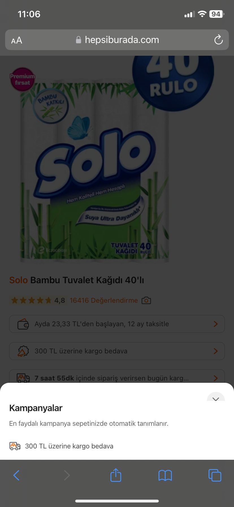

# Campaign information panel cannot be closed
<!-- standardized-defect-report -->

| Field | Value |
| --- | --- |
| Defect ID | DEF-HB-004 |
| Status | Documented |
| Type | Functional |
| Severity | Not recorded |
| Priority | Not recorded |
| Reproducibility | Not recorded |
| Platform | Mobile Web |
| Evidence | Included in the report |

[Back to portfolio](../../README.md) · [Türkçe sürüm](../../Turkish-Reports/hepsiburada-mobile-web-defects/campaign-information-panel-cannot-be-closed.md)

## Preconditions

Not recorded.

## Area

Product page

## Steps to Reproduce

1. Open Safari.
2. Go to https://hepsiburada.com/.
3. Search for "Solo Bambu Tuvalet Kağıdı 40'lı".
4. Open the first product in the search results.
5. Click "300 TL üzerine kargo bedava" (free shipping on orders over TRY 300).
6. Verify that the detailed campaign information panel opens.

## Evidence

## Expected Result

The campaign panel should close when the user clicks the close (X) button, returning the user to the previous view.

## Actual Result

The close (X) button does not respond, so the user cannot exit the campaign panel. Part of the close button is also not visible.

## Test Environment

*Device:* Iphone 11

*OS Version:* iOS 17.6.1

*Display Resolution:* 828x1792 px

*Browser:* Safari 17.6.1

*Issue Reproduction Time:* 07.09.2024 , 11:06

## Impact

Not formally assessed in the original test session.

## Workaround

No workaround was documented during the original test session.
