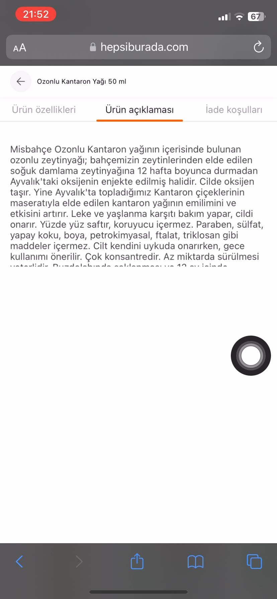

# Product description text is not readable
<!-- standardized-defect-report -->

| Field | Value |
| --- | --- |
| Defect ID | DEF-HB-003 |
| Status | Documented |
| Type | UI/UX |
| Severity | Not recorded |
| Priority | Not recorded |
| Reproducibility | Not recorded |
| Platform | Mobile Web |
| Evidence | Included in the report |

[Back to portfolio](../../README.md) · [Türkçe sürüm](../../Turkish-Reports/hepsiburada-mobile-web-defects/product-description-text-is-not-readable.md)

## Preconditions

Not recorded.

## Area

Product details

## Steps to Reproduce

1. Open Safari.
2. Go to https://hepsiburada.com/.
3. Search for "Misbahçe Ozonlu Kantaron Yağı 50 ml".
4. Open the first product in the search results.
5. Scroll down to the product details.
6. Click the link in "Ürünlerinizi 14 gün içerisinde iade edebilirsiniz. Detaylı bilgi için tıklayın." (returns within 14 days; click for details).
7. Verify that the return conditions page opens.
8. Click "Ürün Açıklaması" (product description).
9. Verify that the product description text is displayed.

## Evidence

## Expected Result

The entire product description should be visible and readable. The text should use the available page width appropriately, or scrolling should be provided when needed.

## Actual Result

The description appears in only one third of the screen. The remaining text is cut off, preventing users from reading all product information.

## Test Environment

*Device:* Iphone 11

*OS Version:* iOS 17.6.1

*Display Resolution:* 828x1792 px

*Browser:* Safari 17.6.1

*Issue Reproduction Time:* 06.09.2024 , 21:52

## Impact

Not formally assessed in the original test session.

## Workaround

No workaround was documented during the original test session.
