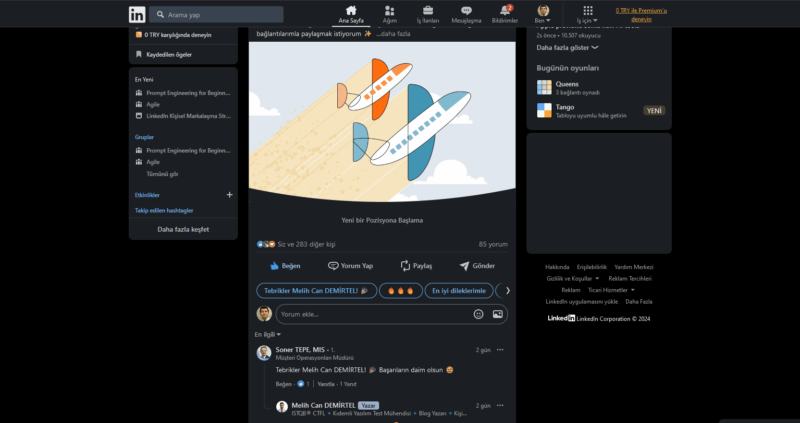

# Cannot view additional congratulation templates
<!-- standardized-defect-report -->

| Field | Value |
| --- | --- |
| Defect ID | DEF-LI-001 |
| Status | Documented |
| Type | Functional |
| Severity | Not recorded |
| Priority | Not recorded |
| Reproducibility | Not recorded |
| Platform | Web |
| Evidence | Included in the report |

[Back to portfolio](../../README.md) · [Türkçe sürüm](../../Turkish-Reports/linkedin-web-defects/cannot-view-additional-congratulation-templates.md)

## Preconditions

The user must be signed in to LinkedIn.

## Area

LinkedIn homepage or a post's comment area

## Steps to Reproduce

1. Open Firefox.
2. Go to https://www.linkedin.com/.
3. Find a feed post from a user who has started a new job.
4. Click "Yorum Yap" (comment).
5. Click the "Daha fazla seçenek" (more options) right-arrow icon in the suggested messages area.

## Evidence

## Expected Result

Additional congratulation templates should load and become selectable when the user clicks the more options icon.

## Actual Result

The icon does not respond and no additional templates appear, preventing access to the other suggestions.

## Test Environment

*Device:* Intel i9-10850K - NVIDIA GEforce RTX 3070 - 16gb RAM

*OS Version:* Windows 11 23H2 Build 22631.4037

*Display Resolution:* 1920x 1080

*Browser:* Firefox 132.0.2 (64-bit)

*Issue Reproduction Time:* 24.10.2024 , 15:32

## Impact

Not formally assessed in the original test session.

## Workaround

No workaround was documented during the original test session.
