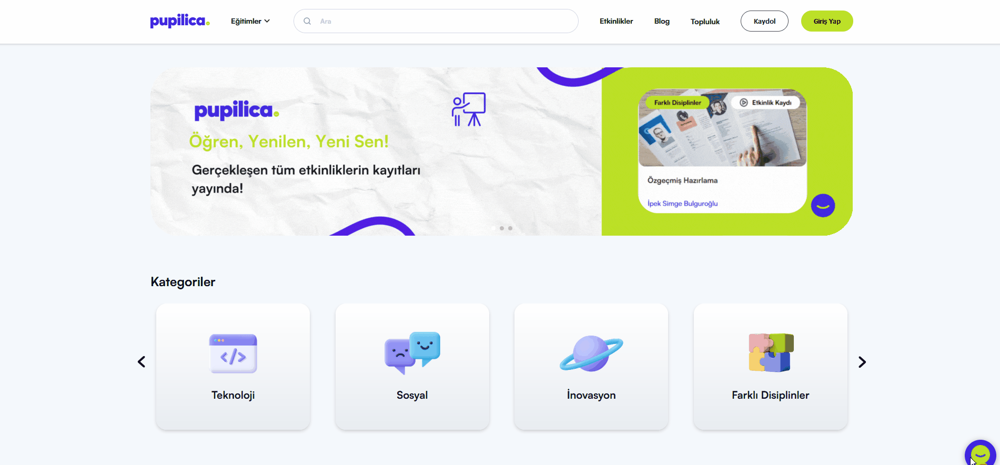

# Video and text overlap on the About page
<!-- standardized-defect-report -->

| Field | Value |
| --- | --- |
| Defect ID | DEF-PU-009 |
| Status | Documented |
| Type | UI/UX |
| Severity | Not recorded |
| Priority | Not recorded |
| Reproducibility | Not recorded |
| Platform | Web |
| Evidence | Included in the report |

[Back to portfolio](../../README.md) · [Türkçe sürüm](../../Turkish-Reports/pupilica-web-defects/about-page-layout-defect.md)

## Preconditions

Not recorded.

## Area

About page

## Steps to Reproduce

1. Go to https://pupilica.com/.
2. Scroll to the bottom of the page.
3. Click "Hakkımızda" (about us).
4. Verify that the About page opens.

## Evidence

## Expected Result

The video visual and text should be positioned correctly without overlapping.

## Actual Result

The video visual and text overlap. Text conflicts with the video, reducing readability and making the page layout appear broken.

## Test Environment

*Device:* Intel i9-10850K - NVIDIA GEforce RTX 3070 - 16gb RAM

*OS Version:* Windows 11 23H2 Build 22631.4037

*Display Resolution:* 1920x 1080

*Browser:* Firefox 129.0.2 (64-bit)

*Issue Reproduction Time:* 06.09.2024 , 17:14

## Impact

Not formally assessed in the original test session.

## Workaround

No workaround was documented during the original test session.
