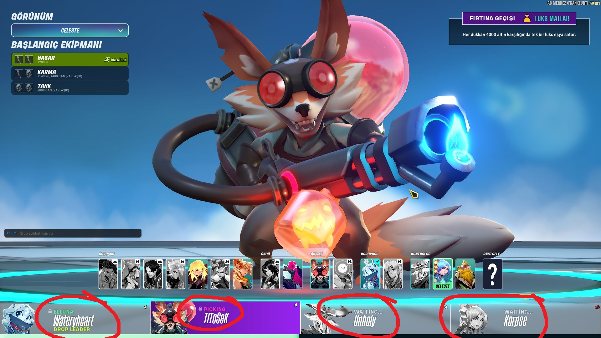

# Language Inconsistency in Character Selection Interface
<!-- standardized-defect-report -->

| Field | Value |
| --- | --- |
| Defect ID | DEF-SV-001 |
| Status | Documented |
| Type | Localization |
| Severity | Medium |
| Priority | Not recorded |
| Reproducibility | Not recorded |
| Platform | PC Game |
| Evidence | Included in the report |

[Back to Software Defect Portfolio](../../../README.md)

## Description
- When the game's language is set to Turkish, the character selection interface still displays in English, leading to inconsistency in the user experience.

## Preconditions
- Language settings: Turkish

## Steps
1. Launch Steam Client.
2. Start Supervive.
3. Go Queue to find the game.
4. Wait for the game to find a match.
5. Navigate to the Character Selection screen.
## Screenshots

## Expected Result
- The character selection interface should appear in Turkish.

## Actual Result
- The character selection interface appears in English despite the Turkish language setting.

## Severity
- Level: Medium

## Test Environment
*Device: Intel i9-10850K - NVIDIA GeForce RTX 3070 - 16GB RAM

*OS Version: Windows 11 23H2, Build 22631.4037

*Display Resolution: 1920x1080

*Platform details: PC

*Steam Client Version: 1726604483

*Supervive version: release0.15.snf-100829-shipping

*Issue Reproduction Time: 19.10.2024, 23:01

## Impact

Not formally assessed in the original test session.

## Workaround

No workaround was documented during the original test session.
