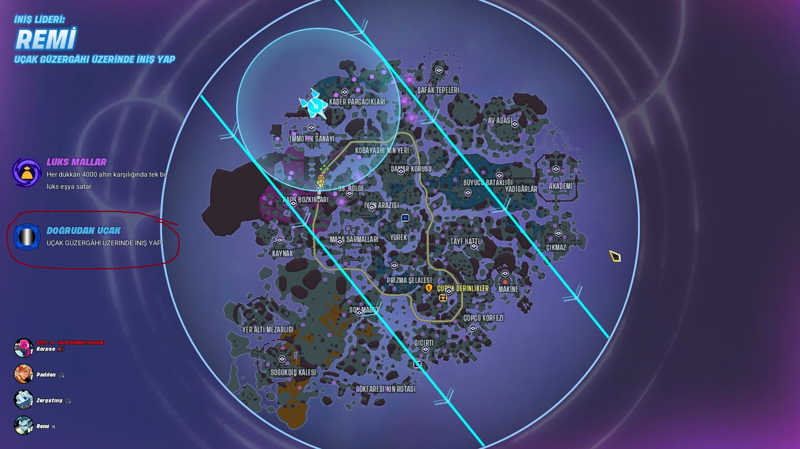

# Map Theme Description Capitalization Inconsistency
<!-- standardized-defect-report -->

| Field | Value |
| --- | --- |
| Defect ID | DEF-SV-004 |
| Status | Documented |
| Type | UI/UX |
| Severity | Low |
| Priority | Not recorded |
| Reproducibility | Not recorded |
| Platform | PC Game |
| Evidence | Included in the report |

[Back to portfolio](../../../README.md) · [Türkçe sürüm](../../../Turkish-Reports/supervive-game-defects/UI-UX-Bug/map-theme-description-capitalization-inconsistency.md)

## Description
- The text for the theme “Doğrudan Uçak” is displayed in all uppercase letters for the description, while other themes typically use lowercase descriptions. This inconsistency can affect the visual coherence of the user interface.

## Preconditions
- Language settings: Turkish

## Steps
1. Launch Steam Client.
2. Start Supervive.
3. Go Queue to find the game.
4. Wait for the game to find a match.
5) Select a character
6) Access the game map and observe the theme name “Doğrudan Uçak” and its description below.

## Screenshots

## Expected Result
- The description for all map themes should follow a consistent text style (either lowercase or sentence case), as seen in other themes.

## Actual Result
- The description for “Doğrudan Uçak” appears in all uppercase letters, unlike the other themes where lowercase letters are used.

## Severity
- Level: Low

## Test Environment
*Device: Intel i9-10850K - NVIDIA GeForce RTX 3070 - 16GB RAM

*OS Version: Windows 11 23H2, Build 22631.4037

*Display Resolution: 1920x1080

*Platform details: PC

*Steam Client Version: 1726604483

*Supervive version: release0.15.snf-100829-shipping

*Issue Reproduction Time: 19.10.2024, 20:12

## Impact

Not formally assessed in the original test session.

## Workaround

No workaround was documented during the original test session.
