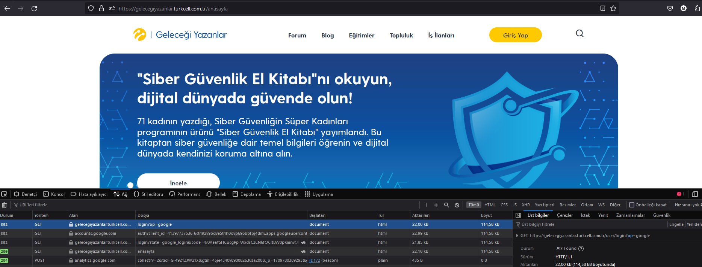

# Google registration and login do not complete
<!-- standardized-defect-report -->

| Field | Value |
| --- | --- |
| Defect ID | DEF-TG-002 |
| Status | Documented |
| Type | Functional |
| Severity | Not recorded |
| Priority | Not recorded |
| Reproducibility | Not recorded |
| Platform | Web |
| Evidence | Included in the report |

[Back to portfolio](../../README.md) · [Türkçe sürüm](../../Turkish-Reports/turkcell-gelecegi-yazanlar-web-defects/google-registration-and-login-issue.md)

## Preconditions

The Google account must be signed in within the browser.

## Area

Login / registration

## Steps to Reproduce

1. Go to https://gelecegiyazanlar.turkcell.com.tr/.
2. Click "Giriş Yap" (sign in).
3. Select Google below the text offering sign-in through other accounts.
4. If the account is signed in, continue; otherwise, a provider login form should appear. The original scenario names Twitter at this step despite testing Google.
5. Enter the two-factor authentication code after signing in.
6. Check whether https://gelecegiyazanlar.turkcell.com.tr/benim-sayfam opens.

## Evidence

## Expected Result

Google sign-in should authenticate the user and redirect to https://gelecegiyazanlar.turkcell.com.tr/benim-sayfam with HTTP 302. The original report calls 302 an error code; it is retained here as the recorded redirect status.

## Actual Result

Google sign-in redirects to https://gelecegiyazanlar.turkcell.com.tr/ without a warning and without completing authentication. Registration has the same issue.

## Test Environment

*Device:* Intel i9-10850K - NVIDIA GEforce RTX 3070 - 16gb RAM

*OS Version:* Windows 11 23h2 Build 22631.3235

*Display Resolution:* 1920x 1080

*Browser:* Firefox 123.0 (64-bit)

*Issue Reproduction Time:* 04.03.2024 , 12:24

## Impact

Not formally assessed in the original test session.

## Workaround

No workaround was documented during the original test session.
