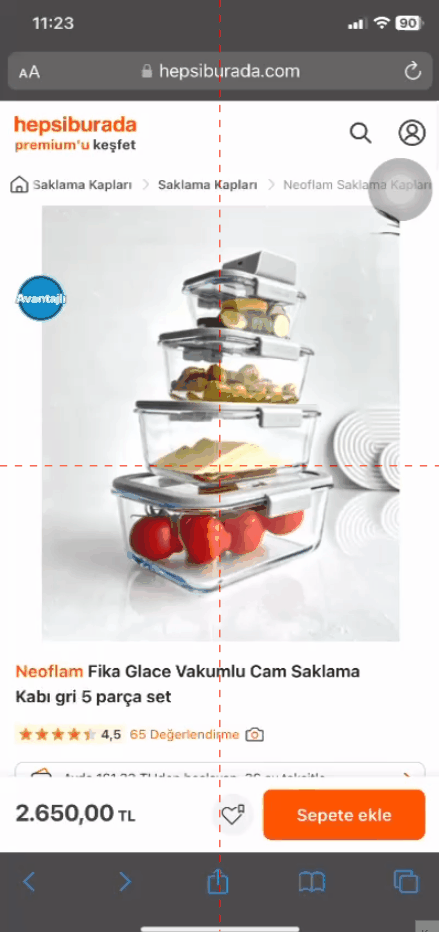

# "Satıcıya Sor" Butonuna Tıklayıp Login Sayfasında Yönlendirdikten Sonra Ürün Sayfasına Geri Dönme Sorunu
<!-- standardized-defect-report -->

| Alan | Değer |
| --- | --- |
| Hata Kimliği | DEF-HB-002 |
| Durum | Raporlandı |
| Tür | Fonksiyonel |
| Önem Derecesi | Kaydedilmedi |
| Öncelik | Kaydedilmedi |
| Tekrarlanabilirlik | Kaydedilmedi |
| Platform | Mobil Web |
| Kanıt | Raporda yer alıyor |

[Ana sayfaya dön](../../README.md) · [English version](../../English-Reports/hepsiburada-mobile-web-defects/cannot-return-to-product-page-after-login-redirect.md)

## Ön Koşullar
- Üye girişi yapılmamış olmalı

## Aşama
- Ürün Özellikleri

## Senaryo
1. Safari açılır.
2. https://hepsiburada.com/ linkine girilir.
3. Arama çubuğuna "neoflam fika glace vakumlu cam saklama kabı bej 5 parça" girilir.
4. Arama sonucundan çıkan ilk ürüne tıklanır.
5. "Satıcıya Sor" butonu kısmına kadar sayfa aşağıya kaydırılır.
6. "Satıcıya Sor" butonu tıklanır.
7. "Seçim Yapın" Dropdown Menüden Ürün Özellikleri seçilir.
8. Konu ile ilgili detay metini girilir.
9. "Soru sor" butonuna tıklanır.
10. Login olma sayfasına yönlendirildiği doğrulanır.
11. Sayfanın sol üst tarafındaki Geriye Dönme butonuna tıklanır.
12. Anasayfaya yönelendirildiği doğrulanır.
## Ekran Görüntüleri

## Beklenen Sonuç
- Kullanıcı, "Satıcıya Sor" butonuna tıklayıp soru sormak için giriş yapmaya yönlendirildiğinde, geri dönme butonuna bastığında ürün sayfasına geri dönmelidir. Bu, kullanıcı deneyimini kesintisiz tutmak için önemli bir navigasyon fonksiyonudur.

## Oluşan Durum
- Kullanıcı, geri dönme butonuna bastığında ürün sayfasına geri dönmek yerine ana sayfaya yönlendiriliyor. Bu, kullanıcıların tekrar ürünü bulmasını zorlaştırıyor ve kullanıcı deneyimini olumsuz etkiliyor.

## Test Ortamı
*Test cihazı:* Iphone 11

*Test cihazı sürümü:* iOS 17.6.1

*Test cihazı ekran çözünürlüğü:* 828x1792 px

*Uygulamanın test edildiği browser:* Safari 17.6.1

*Sorunun Tekrarlanma Saati:* 06.09.2024 , 11:23

## Etki

İlk test oturumunda resmi bir etki değerlendirmesi yapılmadı.

## Geçici Çözüm

İlk test oturumunda geçici çözüm belgelenmedi.
