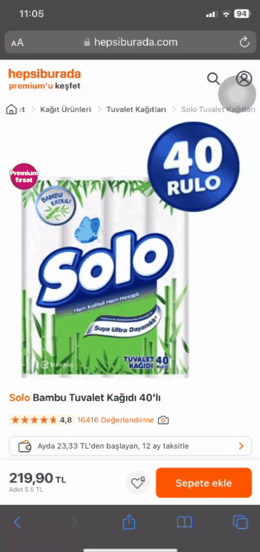

# Odeme Firsatları Secenegine Tiklandiginda Acilan Sayfanin Kapanmama Sorunu
<!-- standardized-defect-report -->

| Alan | Değer |
| --- | --- |
| Hata Kimliği | DEF-HB-001 |
| Durum | Raporlandı |
| Tür | Fonksiyonel |
| Önem Derecesi | Kaydedilmedi |
| Öncelik | Kaydedilmedi |
| Tekrarlanabilirlik | Kaydedilmedi |
| Platform | Mobil Web |
| Kanıt | Raporda yer alıyor |

[Ana sayfaya dön](../../README.md) · [English version](../../English-Reports/hepsiburada-mobile-web-defects/payment-options-panel-cannot-be-closed.md)

## Ön Koşullar
-

## Aşama
- Ürün Sayfasi

## Senaryo
1. Safari açılır.
2. https://hepsiburada.com/ linkine girilir.
3. Arama çubuğuna "Solo Bambu Tuvalet Kağıdı 40'lı" girilir.
4. Arama sonucundan çıkan ilk ürüne tıklanır.
5. "Ayda 23,33 TL’den başlayan, 12 ay taksitle" yazısına tıklanır.
6. Açılan sekmede ayrıntılı bilgi sayfası açıldığı doğrulanır.
## Ekran Görüntüleri

## Beklenen Sonuç
- "Ayda 23,33 TL’den başlayan, 12 ay taksitle" kampanya sekmesi açıldığında, kullanıcılar sekmeyi kapatabilmek için çarpı (X) butonuna tıklamalıdır. Çıkış butonunun düzgün çalışarak kullanıcıyı kampanya sekmesinden çıkarması gerekir.

## Oluşan Durum
- Çarpı (X) butonu tıklanmasına rağmen hiçbir tepki vermiyor ve kullanıcı kampanya sekmesinden çıkış yapamıyor.

## Test Ortamı
*Test cihazı:* Iphone 11

*Test cihazı sürümü:* iOS 17.6.1

*Test cihazı ekran çözünürlüğü:* 828x1792 px

*Uygulamanın test edildiği browser:* Safari 17.6.1

*Sorunun Tekrarlanma Saati:* 06.09.2024 , 11:05

## Etki

İlk test oturumunda resmi bir etki değerlendirmesi yapılmadı.

## Geçici Çözüm

İlk test oturumunda geçici çözüm belgelenmedi.
