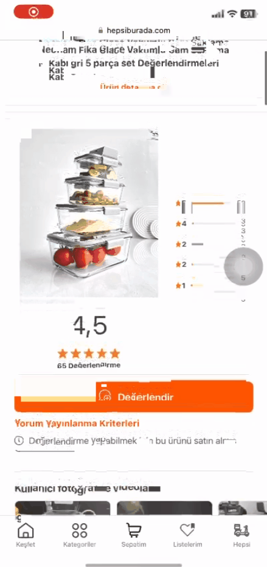

# Yorum Yayınlama Kriterleri Bilgilendirme Sayfasından Çıkış Seçeneği Eksik
<!-- standardized-defect-report -->

| Field | Value |
| --- | --- |
| Defect ID | DEF-HB-006 |
| Status | Documented |
| Type | Functional |
| Severity | Not recorded |
| Priority | Not recorded |
| Reproducibility | Not recorded |
| Platform | Mobile Web |
| Evidence | Included in the report |

[Back to Software Defect Portfolio](../../README.md)

## Ön Koşullar
- Üye girişi yapılmamış olmalı

## Aşama
- Ürün Özellikleri

## Senaryo
1. Safari açılır.
2. https://hepsiburada.com/ linkine girilir.
3. Arama çubuğuna "neoflam fika glace vakumlu cam saklama kabı bej 5 parça" girilir.
4. Arama sonucundan çıkan ilk ürüne tıklanır.
5. Ürün Sayfasının açıldığı doğrulanır
6. "Değerlendir" butonu altındaki "Yorum Yapma Kriterleri" yazısına tıklanır.
7. "Yorum Yapma Kriterleri" metini görüntülenir
8. Konu ile ilgili detay metini girilir.
## Ekran Görüntüleri

## Beklenen Sonuç
- Kullanıcı, yorum yayınlama butonuna bastığında gelen ekranda, işlemi iptal edebilmesi veya ekranı kapatıp önceki sayfaya dönebilmesi için görünür ve işlevsel bir "Çıkış" veya "İptal" butonu olmalıdır. Bu seçenek, kullanıcıya işlemi sonlandırma imkânı sunmalıdır.

## Oluşan Durum
- Yorum yayınlama butonuna basıldıktan sonra gelen ekranda herhangi bir çıkış veya iptal seçeneği bulunmuyor. Kullanıcı, bu ekrandan çıkış yapamadığı için zorlanıyor ve sayfa üzerinde sıkışmış hissediyor, bu da kullanıcı deneyimini olumsuz etkiliyor.

## Test Ortamı
*Test cihazı:* Iphone 11

*Test cihazı sürümü:* iOS 17.6.1

*Test cihazı ekran çözünürlüğü:* 828x1792 px

*Uygulamanın test edildiği browser:* Safari 17.6.1 

*Sorunun Tekrarlanma Saati:* 07.09.2024 , 11:34

## Impact

Not formally assessed in the original test session.

## Workaround

No workaround was documented during the original test session.
