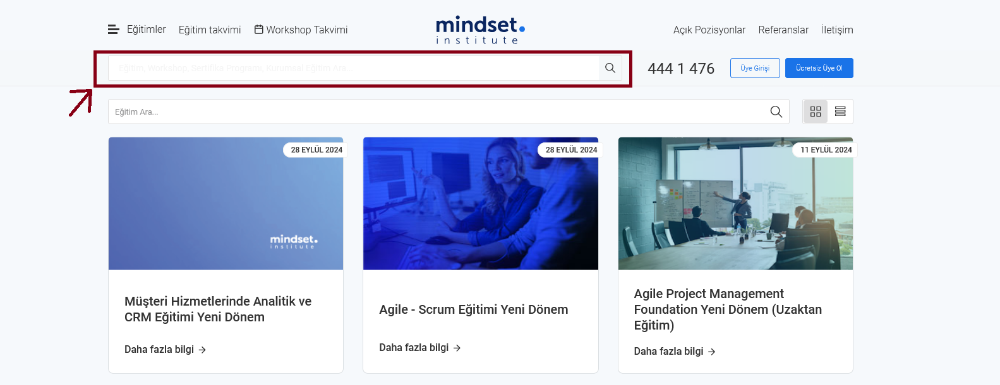

# Eğitimler Sayfasında Fazladan Arama Çubuğu Olması Sorunu
<!-- standardized-defect-report -->

| Alan | Değer |
| --- | --- |
| Hata Kimliği | DEF-MS-002 |
| Durum | Raporlandı |
| Tür | Fonksiyonel |
| Önem Derecesi | Kaydedilmedi |
| Öncelik | Kaydedilmedi |
| Tekrarlanabilirlik | Kaydedilmedi |
| Platform | Web |
| Kanıt | Raporda yer alıyor |

[Ana sayfaya dön](../../README.md) · [English version](../../English-Reports/mindset-web-defects/duplicate-search-bar-on-training-page.md)

## Ön Koşullar
-

## Aşama
- Eğitimler Sayfası

## Senaryo
1. https://www.mindset.com.tr/ linkine girilir.
2. Navigasyon Bar'daki Eğitimler seçeneğine tıklanır
3. Kullanıcının Eğitimler sayfasında olduğu doğrulanır
## Ekran Görüntüleri

## Beklenen Sonuç
- Kullanıcı Eğitimler sayfasında eğitimleri filtreleyebilmesi için Arama Çubuğu olmalı.

## Oluşan Durum
- Eğitimler sayfasında aynı işlevi gören iki tane Arama Çubuğu mevcut.

## Test Ortamı
*Test cihazı:* Intel i9-10850K - NVIDIA GEforce RTX 3070 - 16gb RAM

*Test cihazı sürümü:* Windows 11 23H2 IS derlemesi 22631.4037

*Test cihazı ekran çözünürlüğü:* 1920x 1080

*Uygulamanın test edildiği browser:* Firefox 129.0.2 (64 bit)

*Sorunun Tekrarlanma Saati:* 26.08.2024 , 03:40

## Etki

İlk test oturumunda resmi bir etki değerlendirmesi yapılmadı.

## Geçici Çözüm

İlk test oturumunda geçici çözüm belgelenmedi.
