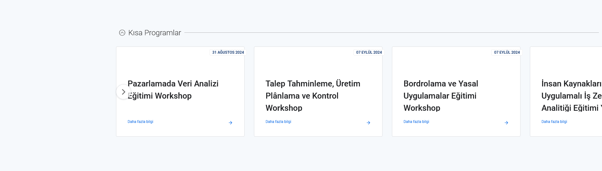

# Ana Sayfadaki Kısa Programlar Bölümünün Ortalanma Sorunu
<!-- standardized-defect-report -->

| Field | Value |
| --- | --- |
| Defect ID | DEF-MS-005 |
| Status | Documented |
| Type | UI/UX |
| Severity | Not recorded |
| Priority | Not recorded |
| Reproducibility | Not recorded |
| Platform | Web |
| Evidence | Included in the report |

[Back to Software Defect Portfolio](../../README.md)

## Ön Koşullar
-

## Aşama
- Ana Sayfa

## Senaryo
1. https://www.mindset.com.tr/ linkine girilir.
2. Sayfa aşağıya doğru kaydırılır
3. Kısa Programlar Bölümü görüntülenir.
## Ekran Görüntüleri
 

## Beklenen Sonuç
- Ana Sayfadaki Kısa Programlar bölümü sayfa düzenine göre ortada olmalıdır.

## Oluşan Durum
- Kısa Programlar Bölümü sayfanın sağ tarafına doğru taşmıştır , ilgili açıklamalar belirgin değildir kullanıcı açısından negatif bir durumdadır.

## Test Ortamı
*Test cihazı:* Intel i9-10850K - NVIDIA GEforce RTX 3070 - 16gb RAM

*Test cihazı sürümü:* Windows 11 23H2 IS derlemesi 22631.4037

*Test cihazı ekran çözünürlüğü:* 1920x 1080

*Uygulamanın test edildiği browser:* Firefox 129.0.2 (64 bit)

*Sorunun Tekrarlanma Saati:* 26.08.2024 , 03:45

## Impact

Not formally assessed in the original test session.

## Workaround

No workaround was documented during the original test session.
