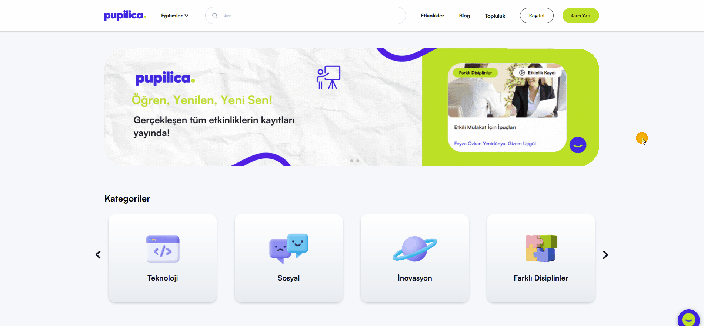

# Eğitimler Sayfasındaki Eğitimlerin A-Z'Ye Yanlış Filtrelenmesi
<!-- standardized-defect-report -->

| Field | Value |
| --- | --- |
| Defect ID | DEF-PU-002 |
| Status | Documented |
| Type | Functional |
| Severity | Not recorded |
| Priority | Not recorded |
| Reproducibility | Not recorded |
| Platform | Web |
| Evidence | Included in the report |

[Back to Software Defect Portfolio](../../README.md)

## Ön Koşullar
-

## Aşama
- Eğitimler Sayfası 

## Senaryo
1. https://pupilica.com/ linkine girilir.
2. Üst Navigasyon Bardan Eğitimler kısmının üzerine mouse imleçi getirilir..
3. Tümünü Gör butonuna tıklanır.
4. Eğitimler sayfasında yönlendirildiği doğrulanır.
5. Eğitim filtreleme seçeneğinden A-Z seçilir.
6. Eğitimlerin A-Z'ye filtrelendiği kontrol edilir.
## Ekran Görüntüleri
 

## Beklenen Sonuç
- Eğitmenler, A-Z'ye göre filtreleme yapıldığında, isimlerine göre alfabetik sırada düzgün bir şekilde listelenmelidir

## Oluşan Durum
- A-Z'ye göre filtreleme düzgün çalışmıyor; bazı isimler doğru sırada yer almıyor. Bu durum, filtreleme fonksiyonunun beklendiği gibi çalışmadığını gösteriyor ve kullanıcıların aradıkları eğitmeni bulmasını zorlaştırıyor.

## Test Ortamı
*Test cihazı:* Intel i9-10850K - NVIDIA GEforce RTX 3070 - 16gb RAM

*Test cihazı sürümü:* Windows 11 23H2 IS derlemesi 22631.4037

*Test cihazı ekran çözünürlüğü:* 1920x 1080

*Uygulamanın test edildiği browser:* Firefox 129.0.2 (64 bit)

*Sorunun Tekrarlanma Saati:* 06.09.2024 , 20:34

## Impact

Not formally assessed in the original test session.

## Workaround

No workaround was documented during the original test session.
