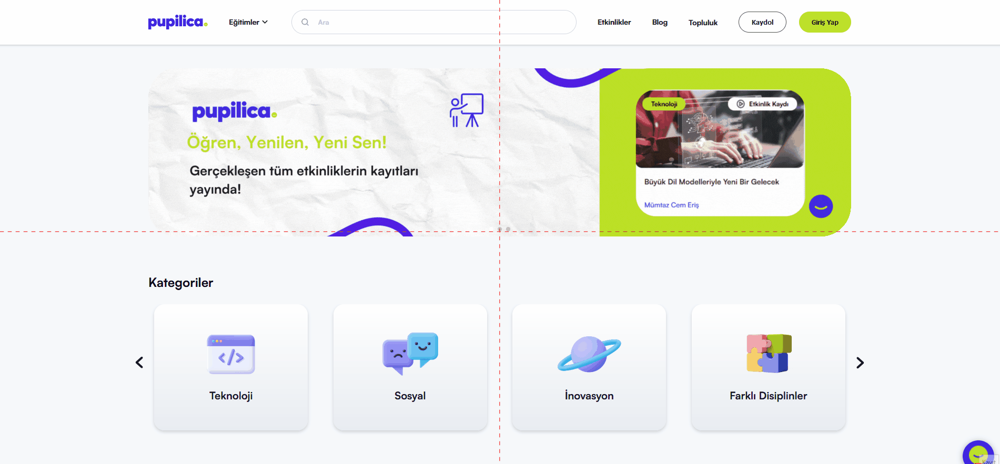

# Eğitmen Kartındaki LinkedIn Profil Bağlantısının Yanlış Yönlendirmesi
<!-- standardized-defect-report -->

| Field | Value |
| --- | --- |
| Defect ID | DEF-PU-004 |
| Status | Documented |
| Type | Functional |
| Severity | Not recorded |
| Priority | Not recorded |
| Reproducibility | Not recorded |
| Platform | Web |
| Evidence | Included in the report |

[Back to Software Defect Portfolio](../../README.md)

## Ön Koşullar
-

## Aşama
- Eğitmenler Sayfasi

## Senaryo
1. https://pupilica.com/ linkine girilir.
2. Sayfanın en altına kadar kaydırılır.
3. Eğitmenler butonuna tıklanır.
4. Eğitmenler sayfasında yönlendirildiği doğrulanır.
5. Sayfa aşağıya kaydırılır ve "  Barış Gürkaş  " isimli eğitmenin kartı doğrulanır.
6. "  Barış Gürkaş  " isimli eğitmenin Linkedin Buttonuna basılır
## Ekran Görüntüleri
 

## Beklenen Sonuç
- Her eğitmen profilinin, LinkedIn profil bağlantısı, tıklanabilir bir buton ile gösterilmeli ve kullanıcılar bu buton üzerinden ilgili eğitmenin LinkedIn sayfasına yönlendirilmelidir.

## Oluşan Durum
- " Barış Gürkaş " isimli eğitmenin kartında bulunan LinkedIn butonu yanlis URL'ye yönlendirme yapıyor. Bu eksiklik, kullanıcıların eğitmenin profesyonel geçmişini görüntülemesini zorlaştırıyor.

## Test Ortamı
*Test cihazı:* Intel i9-10850K - NVIDIA GEforce RTX 3070 - 16gb RAM

*Test cihazı sürümü:* Windows 11 23H2 IS derlemesi 22631.4037

*Test cihazı ekran çözünürlüğü:* 1920x 1080

*Uygulamanın test edildiği browser:* Firefox 129.0.2 (64 bit)

*Sorunun Tekrarlanma Saati:* 06.09.2024 , 20:24

## Impact

Not formally assessed in the original test session.

## Workaround

No workaround was documented during the original test session.
