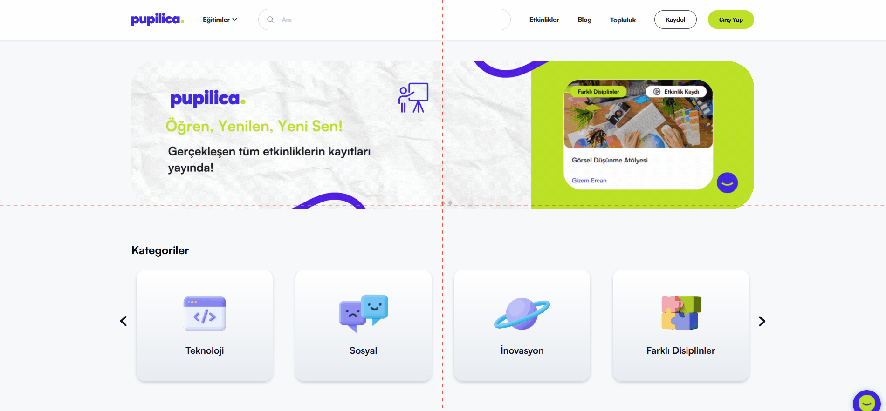

# Etkinlikler Sayfasındaki Etkinlik Türü Filtrelemesinin Tepkisizliği
<!-- standardized-defect-report -->

| Field | Value |
| --- | --- |
| Defect ID | DEF-PU-008 |
| Status | Documented |
| Type | Functional |
| Severity | Not recorded |
| Priority | Not recorded |
| Reproducibility | Not recorded |
| Platform | Web |
| Evidence | Included in the report |

[Back to Software Defect Portfolio](../../README.md)

## Ön Koşullar
-

## Aşama
- Etkinlikler Sayfası

## Senaryo
1. https://pupilica.com/ linkine girilir.
2. Navigasyon Bardan Etkinlikler seçeneğine tıklanır.
3. Etkinlikler Sayfasina yönlendirildiği doğrulanır
4. Etkinlik Türü Filtrelemesindeki "Webinar" seçeneğine tıklanır.
5. Filtrelenen seçeneğin sonuçları kontrol edilir.
## Ekran Görüntüleri
 

## Beklenen Sonuç
- Bir filtreleme seçeneği seçildiğinde, ilgili liste veya içerik filtrelenmeli ve sonuçlar seçilen kritere göre güncellenmelidir. Kullanıcı, filtreleme işleminin başarılı olduğunu görmeli ve içerik, seçilen filtreyle eşleşen sonuçları göstermelidir.

## Oluşan Durum
- Seçilen filtreleme seçeneği hiçbir etki göstermiyor, sayfa tepkisiz kalıyor ve içerik güncellenmiyor. Bu, filtreleme özelliğinin çalışmadığını ve kullanıcının istediği sonuçları göremediğini gösteriyor.

## Test Ortamı
*Test cihazı:* Intel i9-10850K - NVIDIA GEforce RTX 3070 - 16gb RAM

*Test cihazı sürümü:* Windows 11 23H2 IS derlemesi 22631.4037

*Test cihazı ekran çözünürlüğü:* 1920x 1080

*Uygulamanın test edildiği browser:* Firefox 129.0.2 (64 bit)

*Sorunun Tekrarlanma Saati:* 07.09.2024 , 10:14

## Impact

Not formally assessed in the original test session.

## Workaround

No workaround was documented during the original test session.
