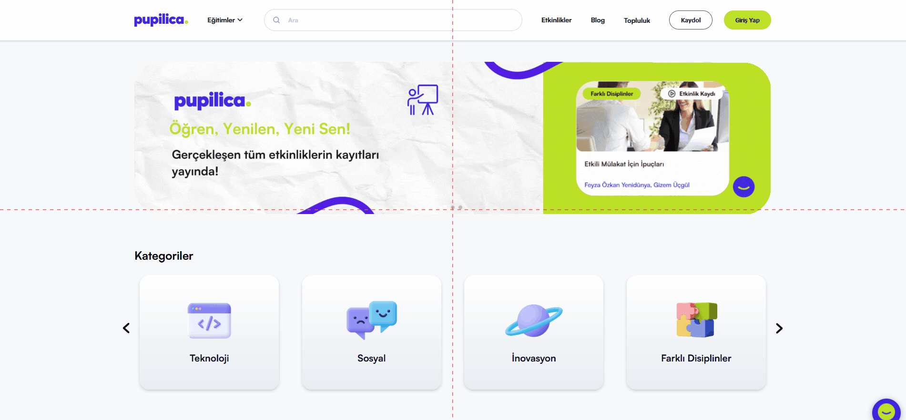

# Etkinlikler Sayfasındaki Beceriler Filtrelemesindeki İsimsiz Filtreleme Seçeneği
<!-- standardized-defect-report -->

| Alan | Değer |
| --- | --- |
| Hata Kimliği | DEF-PU-007 |
| Durum | Raporlandı |
| Tür | Fonksiyonel |
| Önem Derecesi | Kaydedilmedi |
| Öncelik | Kaydedilmedi |
| Tekrarlanabilirlik | Kaydedilmedi |
| Platform | Web |
| Kanıt | Raporda yer alıyor |

[Ana sayfaya dön](../../README.md) · [English version](../../English-Reports/pupilica-web-defects/skills-filter-contains-unnamed-option.md)

## Ön Koşullar
-

## Aşama
- Etkinlikler Sayfası

## Senaryo
1. https://pupilica.com/ linkine girilir.
2. Navigasyon Bardan Etkinlikler seçeneğine tıklanır.
3. Etkinlikler Sayfasina yönlendirildiği doğrulanır
4. Beceri filtrelemesindeki isimsiz filtreleme seçeneği görüntülenir.
## Ekran Görüntüleri

## Beklenen Sonuç
- Tüm filtreleme seçeneklerinin, kullanıcılara neyi filtreleyeceklerini açıkça belirten bir etiket ya da başlığa sahip olması gerekir. Her filtre seçeneği anlamlı ve kullanımı kolay olmalı, isimsiz seçenek olmamalıdır.

## Oluşan Durum
- Filtreleme seçenekleri arasında isimsiz bir seçenek bulunuyor, bu da kullanıcıların neyi filtrelediklerini anlayamamasına neden oluyor. Bu durum, kullanıcı deneyimini olumsuz etkileyebilir ve işlevselliği azaltabilir.

## Test Ortamı
*Test cihazı:* Intel i9-10850K - NVIDIA GEforce RTX 3070 - 16gb RAM

*Test cihazı sürümü:* Windows 11 23H2 IS derlemesi 22631.4037

*Test cihazı ekran çözünürlüğü:* 1920x 1080

*Uygulamanın test edildiği browser:* Firefox 129.0.2 (64 bit)

*Sorunun Tekrarlanma Saati:* 07.09.2024 , 10:00

## Etki

İlk test oturumunda resmi bir etki değerlendirmesi yapılmadı.

## Geçici Çözüm

İlk test oturumunda geçici çözüm belgelenmedi.
