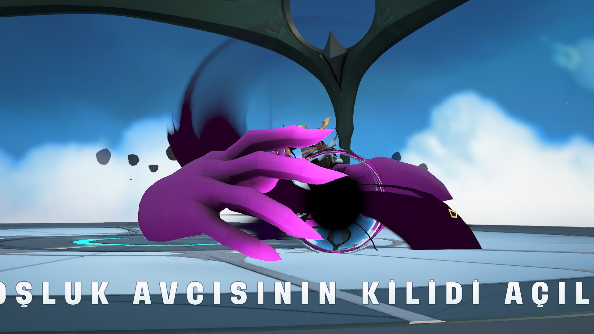
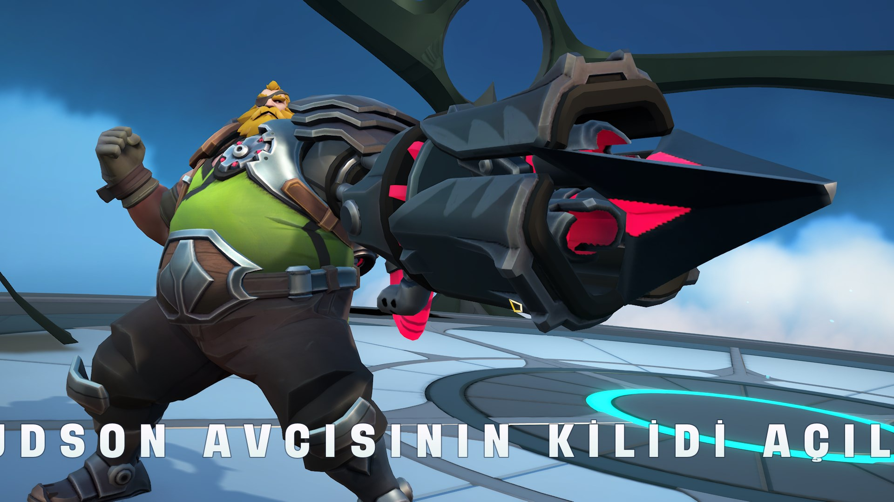

# Karakter açma ekranındaki ad ve mesaj ekrana sığmıyor
<!-- standardized-defect-report -->

| Alan | Değer |
| --- | --- |
| Hata Kimliği | DEF-SV-003 |
| Durum | Raporlandı |
| Tür | UI/UX |
| Önem Derecesi | Düşük |
| Öncelik | Kaydedilmedi |
| Tekrarlanabilirlik | Kaydedilmedi |
| Platform | PC Oyunu |
| Kanıt | Raporda yer alıyor |

[Ana sayfaya dön](../../../README.md) · [English version](../../../English-Reports/supervive-game-defects/UI-UX-Bug/character-unlock-message-inconsistency.md)

## Açıklama

Ödül olarak yeni bir karakter açıldığında, karakterin adı ve açıldığını onaylayan mesaj ekrana düzgün biçimde sığmıyor.

## Ön Koşullar

Karakter ödülünü açmak için ilgili görevi veya mücadeleyi tamamlayın.

## Yeniden Oluşturma Adımları

1. Steam istemcisini başlatın.
2. Supervive oyununu başlatın.
3. Eşleşme aramak için sıraya girin.
4. Oyunun bir eşleşme bulmasını bekleyin.
5. Bir karakter seçin ve deneyim puanı kazanarak oyunu tamamlayın.
6. Yeterli deneyim puanını kazandıktan sonra ödüller aracılığıyla yeni bir karakter açın.
7. Karakter açma animasyonu ekranına geçin.

## Kanıtlar

## Beklenen Sonuç

Karakter adı ve onay mesajı, ekranda kendileri için ayrılan alana düzgün biçimde sığmalıdır.

## Gerçekleşen Sonuç

Hem karakter adı hem de açılma mesajı ayrılan alanın dışına taşıyor ve okunmaları zorlaşıyor.

## Önem Derecesi

Seviye: Düşük. Bu küçük arayüz sorunu oynanış işlevlerini etkilemiyor; ancak kullanıcı deneyimini ve okunabilirliği etkiliyor.

## Test Ortamı

*Cihaz: Intel i9-10850K - NVIDIA GeForce RTX 3070 - 16GB RAM

*İşletim sistemi sürümü: Windows 11 23H2, Derleme 22631.4037

*Ekran çözünürlüğü: 1920x1080

*Platform ayrıntıları: PC

*Steam istemci sürümü: 1726604483

*Supervive sürümü: release0.15.snf-100829-shipping

*Hatanın tekrarlandığı tarih ve saat: 19.10.2024, 21:11

## Etki

İlk test oturumunda resmi bir etki değerlendirmesi yapılmadı.

## Geçici Çözüm

İlk test oturumunda geçici çözüm belgelenmedi.
