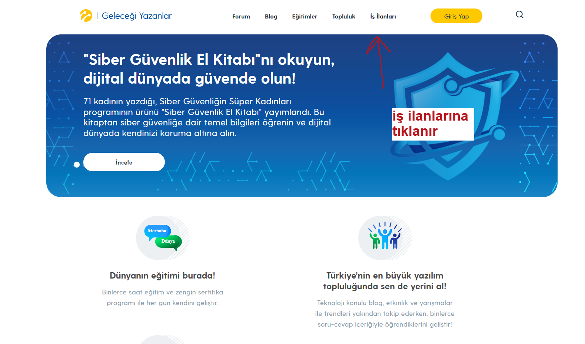
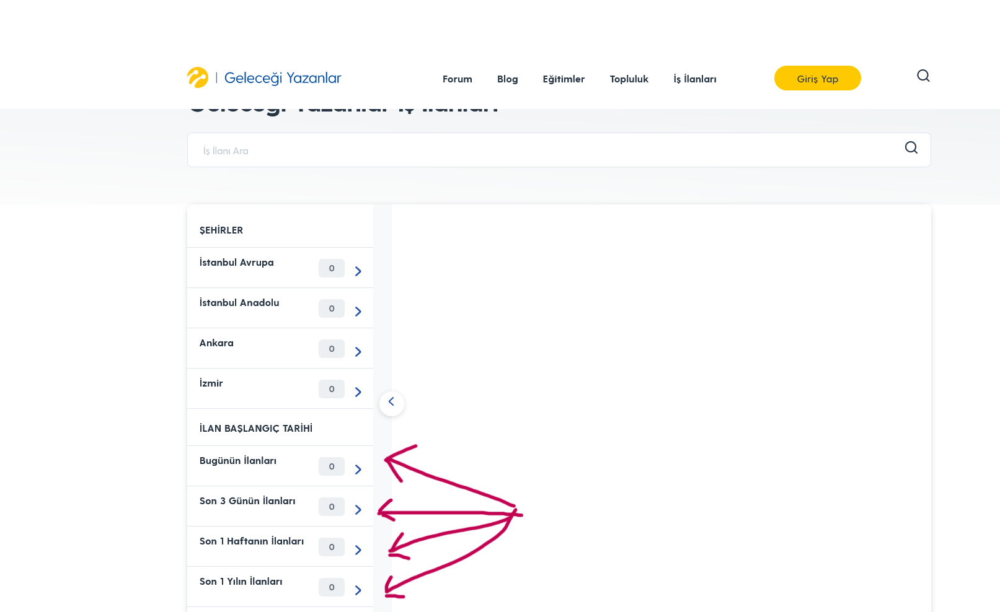
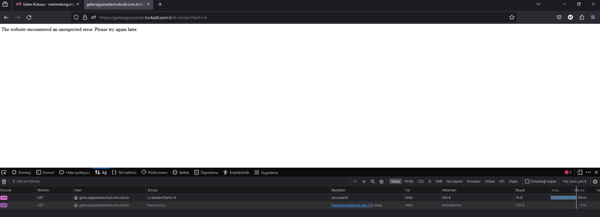

# =  Ilan baslangıç tarihi bölümündeki filtreleme butonlarının çalışmaması
<!-- standardized-defect-report -->

| Alan | Değer |
| --- | --- |
| Hata Kimliği | DEF-TG-003 |
| Durum | Raporlandı |
| Tür | Fonksiyonel |
| Önem Derecesi | Kaydedilmedi |
| Öncelik | Kaydedilmedi |
| Tekrarlanabilirlik | Kaydedilmedi |
| Platform | Web |
| Kanıt | Raporda yer alıyor |

[Ana sayfaya dön](../../README.md) · [English version](../../English-Reports/turkcell-gelecegi-yazanlar-web-defects/job-posting-start-date-filters-do-not-work.md)

*Test cihazı:* Intel i9-10850K - NVIDIA GEforce RTX 3070 - 16gb RAM

*Test cihazı sürümü:* Windows 11 23h2 IS derlemesi 22631.3235

*Test cihazı ekran çözünürlüğü:* 1920x 1080

*Uygulamanın test edildiği browser:* Firefox 123.0 (64 bit)

*Sorunun Tekrarlanma Saati:* 07.03.2024 , 105:46

## Ön Koşullar
-

## Aşama
- Filtreleme

## Senaryo
. https://gelecegiyazanlar.turkcell.com.tr/ linkine girilir. 
. "İş İlanları" seçeneğine tıklanır. 
. "İLAN BAŞLANGIÇ TARİHİ" bölümündeki "Bugünün İlanları" , "Son 3 Günün İlanları" , "Son 1 Haftanın İlanları" , "Son 1 Yılın Ilanları" filtreleme butonlarına tıklanır 
. Tıklanan filtreleme seçeneğine göre ilanlar varsa ekrana getirilir yoksa ilan yoktur diye uyarı verir. 

## Oluşan Durum
. Filtreleme butonuna basıldığında "The website encountered an unexpected error. Please try again later." 500 kodu hatası görülmüştür

## Beklenen Sonuç
- İş İlanlarının filtrelenmesi, eğer iş ilanı yoksa uyarı mesajı vermesi.

## Etki

İlk test oturumunda resmi bir etki değerlendirmesi yapılmadı.

## Geçici Çözüm

İlk test oturumunda geçici çözüm belgelenmedi.
