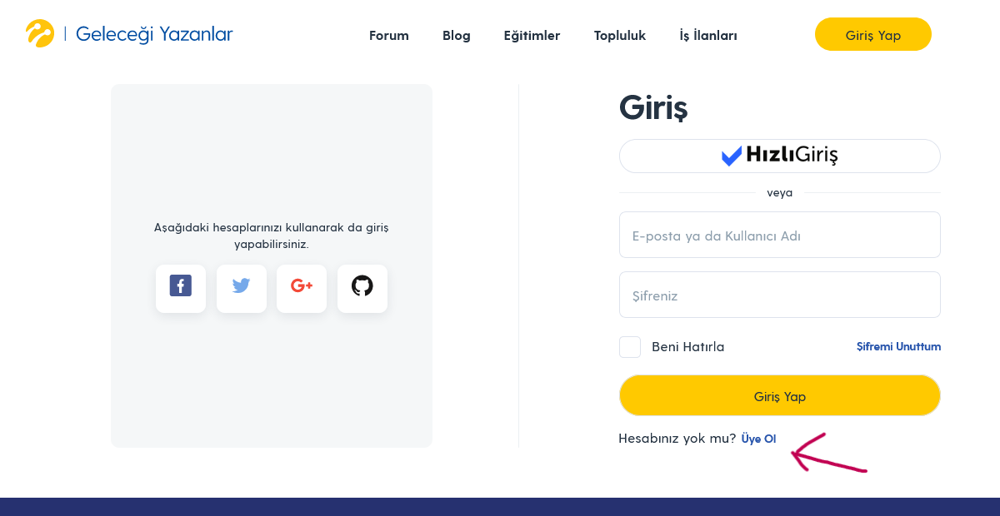
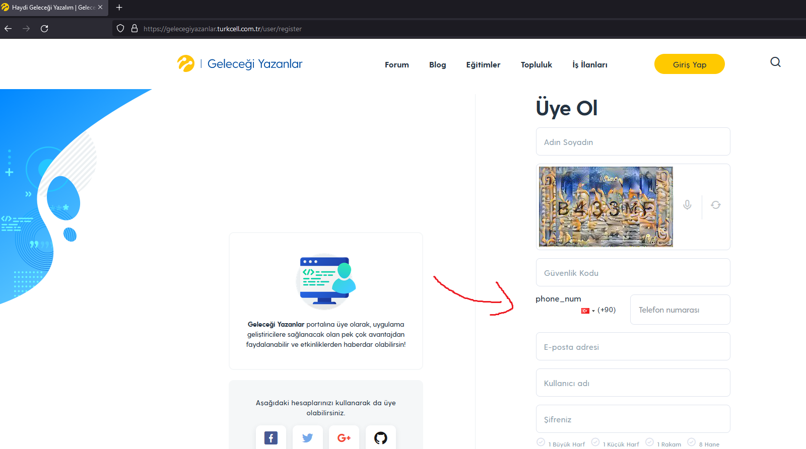

# =  Uye olma formu sorunu
<!-- standardized-defect-report -->

| Alan | Değer |
| --- | --- |
| Hata Kimliği | DEF-TG-005 |
| Durum | Raporlandı |
| Tür | Fonksiyonel |
| Önem Derecesi | Kaydedilmedi |
| Öncelik | Kaydedilmedi |
| Tekrarlanabilirlik | Kaydedilmedi |
| Platform | Web |
| Kanıt | Raporda yer alıyor |

[Ana sayfaya dön](../../README.md) · [English version](../../English-Reports/turkcell-gelecegi-yazanlar-web-defects/registration-form-issue.md)

*Test cihazı:* Intel i9-10850K - NVIDIA GEforce RTX 3070 - 16gb RAM

*Test cihazı sürümü:* Windows 11 23h2 IS derlemesi 22631.3235

*Test cihazı ekran çözünürlüğü:* 1920x 1080

*Uygulamanın test edildiği browser:* Firefox 123.0 (64 bit)

*Sorunun Tekrarlanma Saati:* 04.03.2024 , 12:24

## Ön Koşullar
-

## Aşama
- Kayıt Olmak

## Senaryo
. https://gelecegiyazanlar.turkcell.com.tr/ linkine girilir. 
. "Giriş Yap" seçeneğine tıklanır. 
. "Hesabınız yok mu?" metinin yanındaki üye ol butonuna basılır. 
. https://gelecegiyazanlar.turkcell.com.tr/user/register adresine yönlendirilir. 
. Üye olma formunun sorunsuz geldiği görüntülenir. 

## Oluşan Durum
. https://gelecegiyazanlar.turkcell.com.tr/user/register aşamasında gelen üye olma formunu olusan bileşenlerden bir kod id'si site arayüzüne yansımıştır.data girilecek kısımlar düzgün hizalanmamıştır

## Beklenen Sonuç
- Kullanıcı https://gelecegiyazanlar.turkcell.com.tr/user/register aşamasına geldiğinde "phone_num" yazısı orada olmamalı ve data girilecek kısımlar düzgün hizalanmamıştır

## Etki

İlk test oturumunda resmi bir etki değerlendirmesi yapılmadı.

## Geçici Çözüm

İlk test oturumunda geçici çözüm belgelenmedi.
