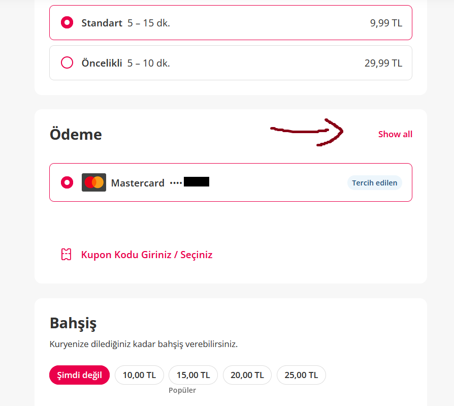

<!-- standardized-defect-report -->

| Field | Value |
| --- | --- |
| Defect ID | DEF-YS-002 |
| Status | Documented |
| Type | UI/UX |
| Severity | Not recorded |
| Priority | Not recorded |
| Reproducibility | Not recorded |
| Platform | Web |
| Evidence | Included in the report |

[← Back to Software Defect Portfolio](../README.md)
# Sipariş Ödeme Sayfası Arayüz Sorunu
## Ön Koşullar
-Yemeksepeti hesabının olması

## Aşama
- Sipariş Ödeme

## Senaryo
. https://www.yemeksepeti.com linkine girilir. 
. Bir restorant seçilir. 
. Bir ürüne tıklanır . 
. Doldurulması zorunlu bölümler işaretlenir 
. "Sepete Ekle" butonuna tıklanır. 
. "Sepeti Onayla" butonuna tıklanır. 

## Ekran Görüntüleri
 

## Beklenen Sonuç
- Sayfa dili Türkçe seçilmişken diğer ödeme yöntemlerini göstermesi için "Hepsini Göster" butonu olmalı.

## Oluşan Durum
- Sayfa dili Türkçe seçilmişken diğer ödeme yöntemlerini göstermesi için "Hepsini Göster" yerine "Show all" yazılmış 

## Test Ortamı
*Test cihazı:* Intel i9-10850K - NVIDIA GEforce RTX 3070 - 16gb RAM

*Test cihazı sürümü:* Windows 11 23H2 IS derlemesi 22631.3810

*Test cihazı ekran çözünürlüğü:* 1920x 1080

*Uygulamanın test edildiği browser:* Firefox 127.0.2 (64 bit)

*Sorunun Tekrarlanma Saati:* 01.07.2024 , 15:34

## Impact

Not formally assessed in the original test session.

## Workaround

No workaround was documented during the original test session.
